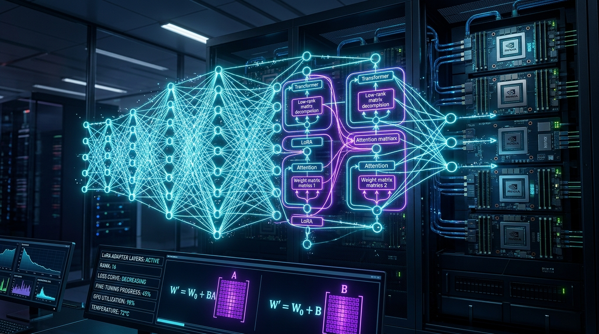

# Glacier.Tune

[](LICENSE)
[](https://dotnet.microsoft.com/)
[](https://learn.microsoft.com/dotnet/core/deploying/native-aot/)
[](https://www.nuget.org/packages/Glacier.Tune/)

`Glacier.Tune` is a LoRA fine-tuning, Direct Preference Optimization (DPO), and GGUF model-merging library written in pure C# for .NET 10.

It memory-maps quantized GGUF base models directly onto CPU SIMD or NVIDIA CUDA VRAM without Python, PyTorch, or the CUDA Toolkit, trains low-rank adapters with checkpointed reverse-mode backpropagation, and exports fused standalone GGUF weights or binary adapters.

## Install

```bash
dotnet add package Glacier.Tune
```

## Quick Start

```csharp
using Glacier.Tune.Config;
using Glacier.Tune.Data;
using Glacier.Tune.Export;
using Glacier.Tune.Model;
using Glacier.Tune.Trainer;

// 1. Memory-map a base GGUF model with LoRA adapters
using var model = GgufLoraModel.Load(
    "models/Qwen2.5-Coder-7B-Instruct-Q4_K_M.gguf",
    new LoraConfig
    {
        Rank = 16,
        Alpha = 32f,
        TargetModules = ["q_proj", "k_proj", "v_proj", "o_proj", "gate_proj", "up_proj", "down_proj"]
    },
    device: "auto");

// 2. Load ChatML training pairs with prompt token masking (-100)
var dataset = ChatMlDataset.FromFile("train.jsonl", model.Tokenizer, maxSeqLength: 512);

// 3. Train with gradient accumulation and cosine LR decay
var args = new TrainingArguments
{
    Device = "auto",
    LearningRate = 2e-4f,
    Epochs = 1,
    GradientAccumulationSteps = 8,
    CheckpointActivations = true,
    OutputDir = "./fine_tuned_lora"
};

using var trainer = new LoraTrainer(model, args);
trainer.Train(dataset);

// 4. Fuse trained LoRA deltas into a standalone GGUF
GgufMerger.Merge(
    "models/Qwen2.5-Coder-7B-Instruct-Q4_K_M.gguf",
    "./fine_tuned_lora/adapter_model.bin",
    "./qwen2.5-coder-7b-tuned-q8_0.gguf",
    new GgufMerger.MergeOptions { TargetQuantization = TargetQuantization.Q8_0 });
```

Or run the sample trainer/merger/evaluator directly:

```bash
dotnet run -c Release --project samples/Glacier.Tune.Demo -- --merge base.gguf adapter_model.bin merged.gguf
```

## What You Can Do

| Capability | Description | Key Types |
| :--- | :--- | :--- |
| **LoRA SFT & Hybrid GDN Training** | Fine-tune standard transformer and hybrid Gated DeltaNet GGUF models with frozen base-weight backprop and activation checkpointing | `GgufLoraModel`, `LoraTrainer`, `TransformerBlock`, `GdnBlock`, `LoraConfig`, `TrainingArguments` |
| **DPO & cDPO Alignment** | Train directly on chosen/rejected JSONL preference pairs with reference log-prob caching and SFT anchoring | `DpoTrainer`, `DpoDataset`, `DpoLoss`, `DpoTrainingArguments` |
| **Tiled Cross-Entropy & Evaluation** | Online tiled Log-Sum-Exp cross-entropy across full vocabularies plus exact-match and F1 post-tune evaluation | `FusedCrossEntropyLoss`, `PostTuneEvaluator`, `StatefulAdamW` |
| **Sleep Consolidation & MoE Growth** | Pre-allocated MoE expansion bank, SIMD dream filtering, and GKD consolidation trainer | `SleepConsolidationTrainer`, `PreallocatedMoeExpansionBank`, `DreamQualityFilter` |
| **Standalone GGUF Fusion** | Merge `.bin` adapters directly back into quantized GGUF (`Auto`, `Q4_K`, `Q6_K`, `Q8_0`, `F16`, `BF16`, `F32`) | `GgufMerger` |

## Platform & Compatibility

- Targets `.NET 10` (`<IsAotCompatible>true</IsAotCompatible>`, `<TreatWarningsAsErrors>true</TreatWarningsAsErrors>`).
- Supports CPU SIMD (`AVX-512` / `AVX2` / `AdvSimd`) and bare-metal NVIDIA CUDA driver execution (`nvcuda.dll` / `libcuda.so.1`) for `Q4_K`, `Q6_K`, `Q8_0`, `Q4_0`, and `F32` weights.

## Benchmarks

Measured with `dotnet run --project benchmarks/Glacier.Tune.Benchmarks/Glacier.Tune.Benchmarks.csproj -c Release` on an AMD Ryzen AI 9 HX 370 (`.NET 10.0.15`, Windows 11):

| Kernel Benchmark | Scope | Measured Latency |
| :--- | :--- | ---: |
| `LoraKernels.ApplyLoraDelta` / `Backward` | `T=512, D=3584, R=16` | **1.434 ms** fwd / **7.957 ms** bwd |
| `RoPEKernel.ForwardSequence` / `BackwardSequence` | `T=128, Hq=28, Hkv=4, D=128` | **89.0 us** fwd / **88.8 us** bwd |
| `SwiGluKernel.Forward` / `Backward` | `T=128, Dffn=18944` (`2.42M` elem) | **0.416 ms** fwd / **1.009 ms** bwd |
| `FusedCrossEntropyLoss.ComputeLossAndGradients` | `T=128, D=3584, V=32000` (`F32`) | **705.042 ms** |
| `DpoLoss.Compute` | Single pair (`1M` iterations) | **29.65 ns / call** |
| `DreamQualityFilter.ComputeScore` | Cosine (`D=1024`) + Levenshtein | **0.273 us / call** |

See [docs/benchmarks.md](docs/benchmarks.md) for all sweep sizes and the 10-step RTX 4060 hardware telemetry run.

## Documentation

- [User Manual](docs/manual.md) — LoRA SFT, dataset formatting, checkpoint resume, DPO alignment, sleep consolidation, GGUF export, and evaluation
- [Architecture](docs/architecture.md) — GGUF mmap loading, activation checkpointing, scratch workspaces, CUDA backward kernels, and adapter binary layout
- [Benchmarks](docs/benchmarks.md) — microbenchmark sweeps and historical RTX 4060 7B run telemetry
- [Changelog](CHANGELOG.md) — release history

## License & Credits

Licensed under the [MIT License](LICENSE). Copyright (c) 2026 Ian Cowley.

Developed by Ian Cowley, Antigravity (Google DeepMind) and Claude.
